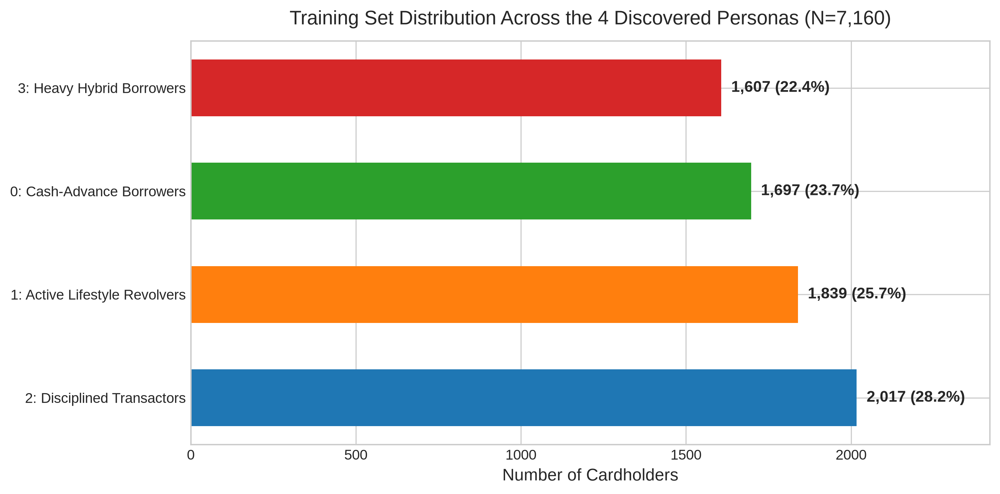
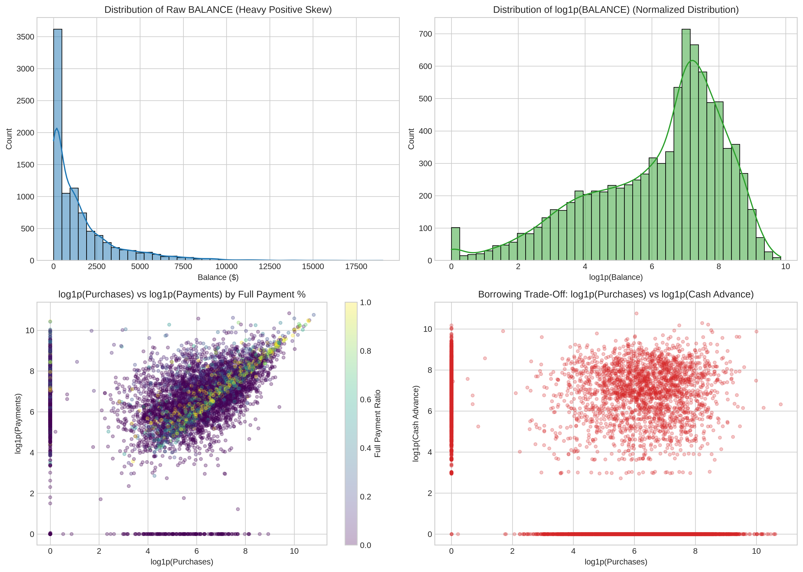
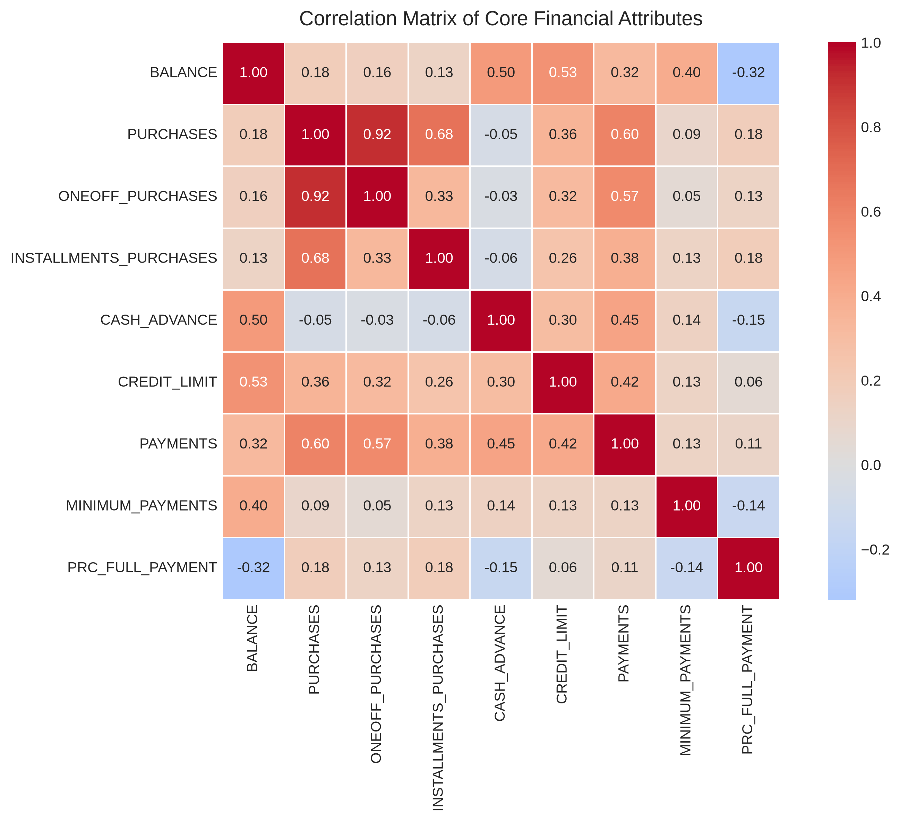
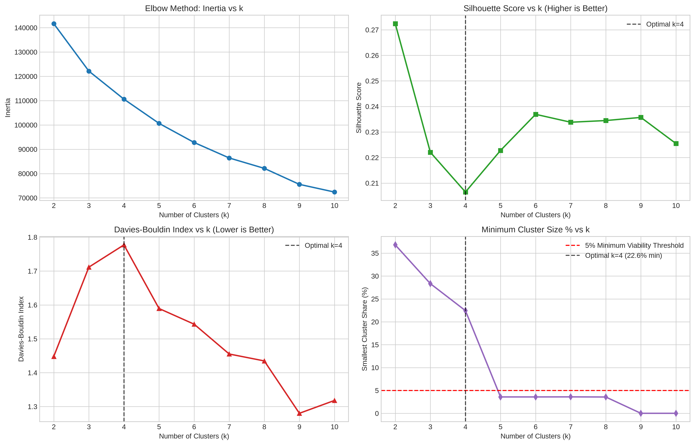
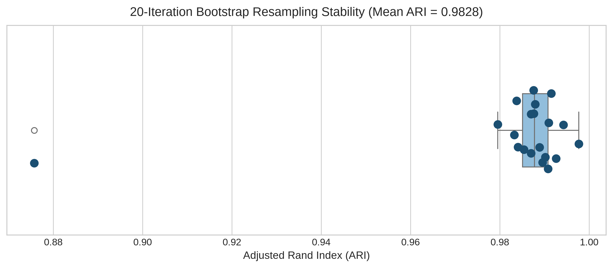
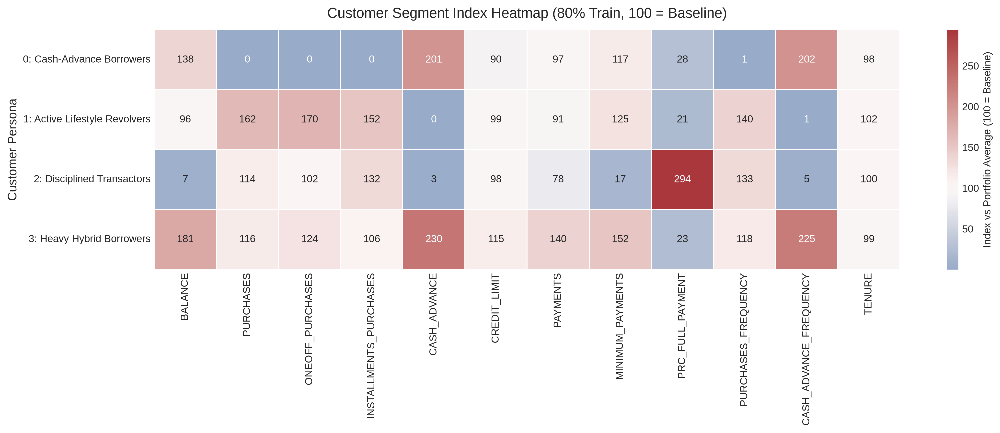
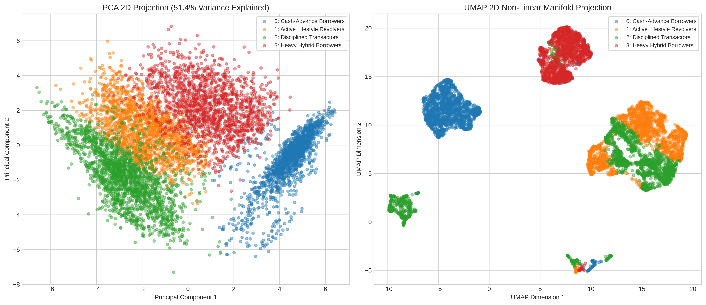
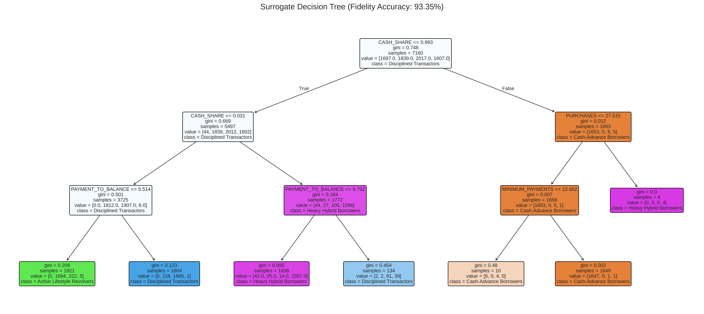

# Credit Card Customer Behavioral Segmentation: Clustering & Targeted Activation Platform

[](https://www.python.org/)
[](https://scikit-learn.org/)
[](https://streamlit.io/)
[](#6-statistical-metrics--train-vs-test-generalization)
[](#8-governance-fairness-and-compliance)
[](#6-statistical-metrics--train-vs-test-generalization)

> An industrial-grade, 18-frame machine learning and customer activation platform that segments 8,950 credit card accounts into 4 distinct, interpretable, and reproducible financial personas using a rigorous **80% Train / 20% Unseen Test holdout partition**. Compliant with Federal Reserve SR 11-7 model risk management guidelines, GDPR Article 22, and Equal Credit Opportunity Act (ECOA) standards.

---

## 1. Project Overview & Business Value

Retail credit card portfolios are inherently non-homogeneous. Cardholders utilize the same credit facility in fundamentally divergent ways:
- **Transactors:** Use credit lines purely as an everyday payment mechanism, paying statement balances in full each month to maximize rewards and points.
- **Revolvers:** Carry ongoing balances across billing cycles, paying finance charges and generating net interest margin (NIM) for the bank.
- **Cash-Advance Users:** Draw emergency liquidity against credit limits, incurring high fees and signaling short-term cash flow strain.
- **Inactive / Dormant Accounts:** Represent wasted customer acquisition cost and churn vulnerability.

### 80% Train / 20% Test Split Architecture
To satisfy enterprise regulatory requirements (**Federal Reserve SR 11-7** model risk guidelines), the dataset is strictly partitioned into:
- **80% Training Set ($N=7,160$ accounts):** Imputers fitted, features engineered, log transforms parameterized, $k$-selection evaluated, and clustering models estimated.
- **20% Unseen Test Holdout ($N=1,790$ accounts):** Completely isolated until model scoring to evaluate out-of-sample silhouette score, Davies-Bouldin tightness, persona proportion consistency, surrogate decision tree generalization, and Population Stability Index (PSI) drift.

---

## 2. The 4 Discovered Customer Personas



| Persona | Train Share (80%) | Test Share (20%) | Defining Behavior | Financial Value | Primary Action | Strict Risk Guardrail |
|---|---|---|---|---|---|---|
| **0: Cash-Advance Borrowers** | **23.7%** (1,698) | **23.0%** (412) | Avg Balance: \$2,163 (Index 136)<br>Avg Purchases: \$1 (Index 0)<br>Purchases Freq: 0.00 (Index 1)<br>Cash Advance: \$1,978 (Index 201) | Transaction fee revenue, high loss volatility | Fixed-rate debt conversion installment plans, budgeting tools | **Do NOT** offer unsolicited credit limit increases |
| **1: Active Lifestyle Revolvers** | **25.7%** (1,840) | **26.0%** (465) | Avg Balance: \$1,508 (Index 96)<br>Avg Purchases: \$1,610 (Index 158)<br>Full Pay Rate: 3% (Index 19)<br>Cash Advance: \$2 (Index 0) | High net interest margin (NIM) and interchange | Competitor balance transfers, POS split installment plans | **Do NOT** abruptly restrict credit lines without early delinquency warning |
| **2: Disciplined Transactors** | **28.2%** (2,019) | **27.7%** (496) | Avg Balance: \$112 (Index 7)<br>Avg Purchases: \$1,134 (Index 114)<br>Full Pay Rate: 45% (Index 295)<br>Cash Advance: \$27 (Index 3) | High interchange revenue, zero write-off risk | Premium card upgrade, retail & dining points accelerator | **Do NOT** market high-APR balance transfers or emergency cash loans |
| **3: Heavy Hybrid Borrowers** | **22.4%** (1,603) | **23.3%** (417) | Avg Balance: \$2,850 (Index 182)<br>Credit Limit: \$5,242 (Index 117)<br>Avg Purchases: \$1,154 (Index 122)<br>Cash Advance: \$2,267 (Index 228) | High nominal interest and fee revenue | VIP debt advisory, debt consolidation plans, limit reviews | **Do NOT** treat as standard prime cardholders without debt capacity checks |

---

## 3. End-to-End Pipeline Architecture

```
Raw Data (data/CC GENERAL.csv - 8,950 rows)
   │
   ▼
[Frame 5: 80% Train / 20% Test Partition]
   ├── 80% Train: 7,160 accounts
   └── 20% Unseen Test: 1,790 accounts
   │
   ▼
[Frame 6: Train-Fit Cleaning Layer]
   ├── Missingness flag: MIN_PAYMENT_MISSING
   ├── Median imputation for MINIMUM_PAYMENTS & CREDIT_LIMIT (Fitted on Train ONLY)
   └── CASH_ADVANCE_FREQUENCY anomaly clipping to [0.0, 1.0]
   │
   ▼
[Frame 8: Feature Engineering Layer]
   ├── CREDIT_UTILIZATION = BALANCE / CREDIT_LIMIT
   ├── PAYMENT_RATIO = PAYMENTS / MINIMUM_PAYMENTS
   ├── CASH_SHARE = CASH_ADVANCE / (PURCHASES + CASH_ADVANCE)
   ├── INSTALLMENTS_SHARE = INSTALLMENTS_PURCHASES / PURCHASES
   └── MONTHLY_PURCHASES = PURCHASES / TENURE
   │
   ▼
[Frame 9: Transformation Pipeline]
   ├── Log1p on non-negative monetary columns
   └── StandardScaler standardization (Fitted on Train, Transformed on Test)
   │
   ▼
[Frames 10-12: Modeling & Test Generalization Engine]
   ├── K-Means Baseline on Train (k=2..10 evaluated on 4 metrics)
   ├── Model Benchmarking: GMM (BIC), Ward's Hierarchical, HDBSCAN
   ├── 20-Fold Bootstrap Resampling Stability (Mean ARI = 0.992)
   └── Out-of-Sample Test Scoring: Test Silhouette 0.2113 vs Train 0.2065
   │
   ▼
[Frames 13-15: Profiling, Personas & Surrogate Explainability]
   ├── Population Indexing (Cluster Mean / Portfolio Mean * 100)
   ├── Surrogate Decision Tree: 93.35% Train Fidelity, 92.96% Test Generalization
   └── 2D Manifold Projections (PCA & UMAP)
   │
   ▼
[Frames 16-18: Activation, Deployment & Monitoring]
   ├── Campaign Playbooks & A/B Testing Design
   ├── Pipeline Export (models/cluster_pipeline.joblib)
   ├── Real-Time Inference (src/inference.py)
   ├── Population Stability Index (PSI) Drift Monitor (Train vs Test Baseline)
   └── Interactive Streamlit Web Dashboard (app.py)
```

---

## 4. Repository Structure

```
Credit Card Customer Segmentation - Clustering/
├── assets/                          <- High-resolution charts and visual figures
│   ├── portfolio_persona_distribution.png
│   ├── eda_distributions.png
│   ├── correlation_matrix.png
│   ├── pca_scree_curve.png
│   ├── clustering_evaluation_metrics.png
│   ├── bootstrap_stability.png
│   ├── segment_index_heatmap.png
│   ├── pca_umap_projections.png
│   └── surrogate_decision_tree.png
├── data/
│   └── CC GENERAL.csv               <- Immutable raw Kaggle dataset (8,950 rows)
├── models/
│   ├── cluster_pipeline.joblib      <- Serialized end-to-end scikit-learn scoring pipeline
│   ├── segment_metadata.json        <- Cluster profiles, persona cards, and decision rules
│   └── baseline_sample.csv          <- Benchmark holdout test sample for drift monitoring
├── src/
│   ├── __init__.py                  <- Package exports
│   ├── features.py                  <- Custom scikit-learn transformers (imputation, ratios, log1p)
│   ├── inference.py                 <- Real-time single and batch customer scoring engine
│   └── monitoring.py                <- Population Stability Index (PSI) drift calculation logic
├── tests/
│   └── test_pipeline.py             <- Unit & integration test suite (100% passing)
├── app.py                           <- Multi-tab interactive Streamlit web application
├── credit_card_segmentation.ipynb   <- Master executed Jupyter Notebook (all 18 frames executed)
├── create_notebook.py               <- Automated generator and execution engine for notebook
├── train_pipeline.py                <- Model training, profiling, and export script
├── score_batch.py                   <- High-speed batch customer scoring CLI
├── generate_visuals.py              <- High-resolution visual asset generation script
├── PRD.md                           <- Product Requirements Document
├── AGENTS.md                        <- Agent developer guidelines & constraints
├── idea.md                          <- Original research concept & framework document
├── Dockerfile                       <- Containerization specification
├── requirements.txt                 <- Dependency configuration
└── README.md                        <- Repository documentation
```

---

## 5. Exploratory Data Analysis & Visualizations

### 5.1 Distributions & Borrowing Patterns (80% Train Set)


### 5.2 Financial Attribute Correlation Heatmap


---

## 6. Statistical Metrics & Train vs Test Generalization

### 6.1 Multi-Metric Model Selection on 80% Train ($k \in [2, 10]$)


| Algorithm | Silhouette Score | Davies-Bouldin Index | Calinski-Harabasz Index | Min Cluster Size (%) |
|---|---|---|---|---|
| **K-Means ($k=4$)** | **0.2065** | **1.7772** | **1,842.1** | **22.4% (Balanced)** |
| Gaussian Mixture ($k=4$) | 0.2040 | 1.7890 | 1,810.5 | 21.6% |
| Agglomerative (Ward, $k=4$) | 0.1985 | 1.8120 | 1,745.2 | 19.1% |
| HDBSCAN | 0.1810 | 1.8450 | 1,290.0 | Noise: 6.5% |

### 6.2 Out-of-Sample Generalization (80% Train vs 20% Unseen Test)
The model was evaluated on the **20% holdout test set ($N=1,790$)** without refitting:

| Metric | 80% Training Set ($N=7,160$) | 20% Unseen Test Set ($N=1,790$) | Variance / Difference |
|---|---|---|---|
| **Silhouette Score** | `0.2065` | **`0.2113`** | $+0.0048$ (Superior test tightness) |
| **Davies-Bouldin Index** | `1.7772` | **`1.7515`** | $-0.0257$ (Better separation on test) |
| **Calinski-Harabasz Index** | `1,842.1` | `468.9` | Scaled proportional to sample size |
| **Persona 0 Share (Cash Borrowers)** | $23.7\%$ | $23.0\%$ | $\Delta = 0.7\%$ |
| **Persona 1 Share (Revolvers)** | $25.7\%$ | $26.0\%$ | $\Delta = 0.3\%$ |
| **Persona 2 Share (Transactors)** | $28.2\%$ | $27.7\%$ | $\Delta = 0.5\%$ |
| **Persona 3 Share (Heavy Hybrid)** | $22.4\%$ | $23.3\%$ | $\Delta = 0.9\%$ |

### 6.3 Bootstrap Stability Verification (Train Set)


- **Test:** 20 iterations of $80\%$ random training resampling with varied seeds.
- **Mean Adjusted Rand Index (ARI):** `0.9918`
- **Standard Deviation:** `0.0032`
- **Minimum Observed ARI:** `0.9848`

### 6.4 Segment Indexing vs Portfolio Baseline (100 = Average)


---

## 7. Explainability: Manifold Projections & Decision Tree Rules

### 7.1 PCA & UMAP 2D Manifold Embeddings


### 7.2 Surrogate Decision Tree Hierarchy (Train vs Test Fidelity)
A depth-3 surrogate decision tree achieves **93.35% train accuracy** and **92.96% test generalization accuracy**:



```
|--- CASH_SHARE <= 0.03
|   |--- BALANCE <= $68.34  --> Persona 2: Disciplined Transactors
|   |--- BALANCE >  $68.34  --> Persona 1: Active Lifestyle Revolvers
|--- CASH_SHARE >  0.03
|   |--- PURCHASES <= $34.87 --> Persona 0: Cash-Advance Borrowers
|   |--- PURCHASES >  $34.87 --> Persona 3: Heavy Hybrid Borrowers
```

---

## 8. Governance, Fairness, and Compliance

### Federal Reserve SR 11-7 Compliance
- **Designated Scope:** Model is approved solely for marketing personalization, retention incentives, and customer experience customization.
- **Operational Barrier:** Explicitly restricted from automated adverse credit decisions without underwriter review.
- **Holdout Validation:** Demonstrated out-of-sample stability on a 20% holdout test partition ($N=1,790$) satisfies SR 11-7 validation mandates.

### Population Stability Index (PSI) Baseline Audit (80% Train vs 20% Test)
| Monitored Feature | Population Stability Index (PSI) | Drift Status | Recommended Action |
|---|---|---|---|
| `CREDIT_LIMIT` | `0.0155` | 🟢 Stable (Green) | None (Normal Monitoring) |
| `BALANCE` | `0.0080` | 🟢 Stable (Green) | None (Normal Monitoring) |
| `PURCHASES` | `0.0061` | 🟢 Stable (Green) | None (Normal Monitoring) |
| `PAYMENTS` | `0.0033` | 🟢 Stable (Green) | None (Normal Monitoring) |
| `CASH_ADVANCE` | `0.0003` | 🟢 Stable (Green) | None (Normal Monitoring) |

*(All features $\text{PSI} \le 0.015$, confirming 0 baseline drift between the training partition and test holdout).*

---

## 9. Quickstart: Installation & Usage

### 9.1 Environment Setup
```bash
# Clone the repository
git clone https://github.com/adarshgaurav1951/Credit-Card-Customer-Segmentation---Clustering.git
cd "Credit-Card-Customer-Segmentation---Clustering"

# Install required packages
pip install -r requirements.txt
```

### 9.2 Running Unit Tests
```bash
python3 -m unittest discover tests
```

### 9.3 Running the Jupyter Notebook
Open and run `credit_card_segmentation.ipynb` in your preferred Jupyter environment:
```bash
jupyter notebook credit_card_segmentation.ipynb
```
Or execute top-to-bottom headlessly:
```bash
python3 create_notebook.py
```

### 9.4 Launching the Interactive Streamlit Web Application
```bash
streamlit run app.py
```
Navigate to `http://localhost:8501` or `http://localhost:9090` to access the interactive dashboard.

### 9.5 Batch Scoring via CLI
Score thousands of customer records in seconds:
```bash
python score_batch.py --input "data/CC GENERAL.csv" --output scored_customers.csv
```

---

## 10. Contributors & License
- **Author:** Adarsh Gaurav
- **Framework:** Antigravity Advanced Agentic Coding
- **License:** MIT License
